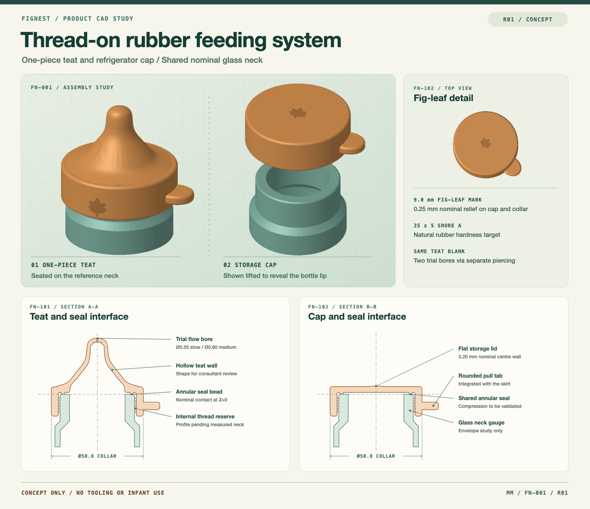

# FigNest R01 · Rubber feeding-bottle closures

An independent concept study for a one-piece natural rubber teat and an interchangeable fridge storage cap. Both parts share the same nominal glass-neck interface. The study includes a hollow teat, a closed storage lid, a common annular seal bead, rounded pull tabs and a 9 mm fig-leaf relief.

| File | Contents |
| --- | --- |
| [Complete CAD kit](./FigNest-R01-CAD-Kit.zip) | ZIP with the STEP models, editable DXF, parametric source, preview and notes |
| [Assembly STEP](./STEP/FN-001-FigNest-Assembly.step) | Teat and storage cap shown on separate instances of the same glass-neck gauge |
| [Individual STEP models](./STEP/) | Teat blank, two example bore variants, storage cap and glass-neck gauge |
| [Assembly and sections DXF](./FN-001-Assembly-Sections-R01.dxf) | Editable sections with material hatching, dimensions and an A3 layout |
| [Parametric CadQuery source](./Build-FigNest.py) | Editable geometry and STEP export routine |
| [Design and tooling notes](./R01-Design-Notes.md) | Assumptions, proposed moulding approach and validation requirements |

**R01 status:** concept only. The glass neck uses assumed dimensions. The internal thread is reserved for measured bottle geometry, and the two example bores have no validated flow rating. The study is not released for tooling or infant use.
